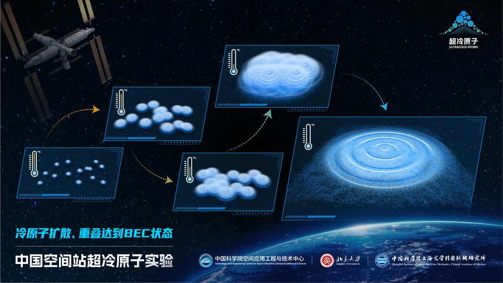
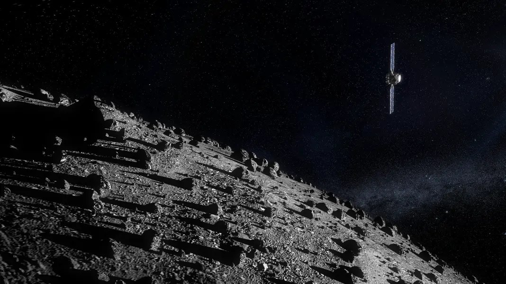
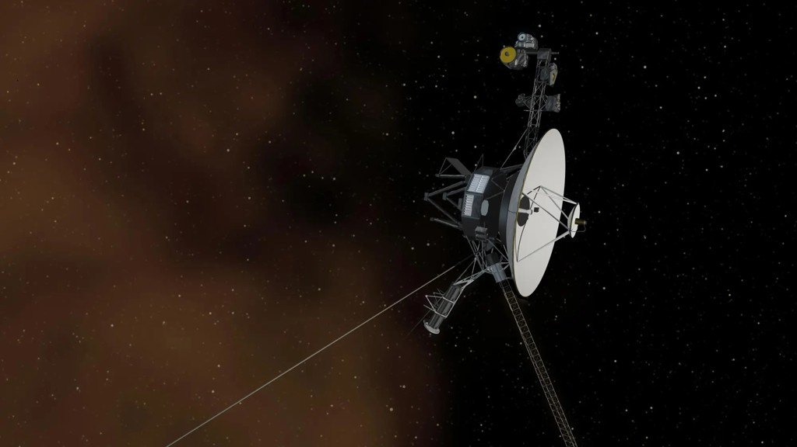

# 20261108期【科技速览】

本期 8 条：科学 4 条、开发 4 条。文中标「预印本」的是未经同行评审的稿件，标「公司发布」的数据来自公司自己。

## 科学

### 1. 空间站把原子冷到了 9.7 皮开尔文

中国空间站的超冷原子实验柜把一团铷原子冷却到 9.7 皮开尔文，是目前已知最低的人造温度，比 2021 年德国团队的 38 pK 更低。团队用全光阱代替磁阱，靠微重力把原子云连续观察了 7 秒。论文 11 月 6 日发表在《Science》。

来源：[中国新闻网 · 中国科学家打破人类低温纪录](https://www.cas.cn/cm/202611/t20261106_5123597.shtml)

### 2. 赫拉第一次看清被撞小行星的背面

欧空局赫拉探测器 11 月 5 日从约 60 公里外拍下迪迪莫斯双小行星，第一次看清主星被 NASA DART 撞过、DART 没拍到的那一面。迪迪莫斯直径约 780 米，卫星迪莫弗斯约 151 米，两者相距约 1 公里。更细的图预计 11 月 25 日公布。

来源：[ESA · Hera's first close-up view of Didymos asteroids](https://www.esa.int/articles/about-us/directorates/operations/space-safety/hera/hera-s-first-close-up-view-of-didymos-asteroids)

### 3. Claude 帮着做出了细菌穹窿体的第一个结构（预印本）

Anthropic 11 月 4 日发布预印本，称用 Claude 解析出细菌和噬菌体穹窿体蛋白的第一个三维结构，蛋白家族从约 41 个扩到 1500 多个。提纯从 3 天缩到 90 分钟。穹窿体的功能仍不清楚；作者全是 Anthropic 员工，公司已申请临时专利。

来源：[Anthropic · Investigating vault particles with Claude](https://www.anthropic.com/research/investigating-vault-particles-with-claude)（公司发布 + 预印本）

### 4. 【趣味位】旅行者 1 号要飞到「一光日」了

旅行者 1 号将在 11 月 18 日飞到距地球约 259 亿公里的位置，正好一光日，成为第一个离地球这么远的人造物。它 1977 年发射。从地面发指令要 24 小时才能到，它回话再等 24 小时，一来一回两天。旅行者 2 号要到 2035 年才到这条线。

来源：[Futura-Sciences · How long does a radio signal take to reach Voyager 1 and back](https://www.futura-sciences.com/en/how-long-does-a-radio-signal-take-to-reach-voyager-1-and-back-once-it-is-a-light-day-away-nasa-answers_902240/)

## 开发

### 5. 苹果公开人形机器人的「大脑」HALO（预印本）

苹果 11 月 4 日公开预印本，介绍人形机器人系统 HALO：在宇树 G1 背上挂一台 Mac mini 跑推理，上层用千问模型拆任务，中层生成约 5 秒的动作。6 个没建图的真实房间里做了 360 次单任务，平均成功率 91%；三个任务连做降到 70%。

来源：[arXiv 预印本（IT之家 转述）· 苹果披露人形机器人 HALO 系统](https://www.ithome.com/0/1023/767.htm)（预印本 + 公司研究，未经同行评审）

### 6. .NET 11 本月发布，C# 15 联合类型不用再开预览

.NET 11 计划本月发布，C# 15 的联合类型不用再加预览开关。写法是 `public union Pet(Cat, Dog)`，对它 switch 不写 default 也能穷尽检查，加新分支会报警告。JSON 序列化也原生支持。.NET 11 是 LTS。

来源：[Microsoft .NET 博客 · Explore new features available in C# 15 preview](https://devblogs.microsoft.com/dotnet/explore-csharp-15/)

### 7. Odin 这个月把 Android 变成一等目标

Odin dev-2026-11 加了 `-subtarget:android`，支持四种 ABI，`odin bundle android` 直接打出签名 APK 或 AAB，另新增 core:diff、LZ4 压缩等标准库，格式化补位默认改为空格。

来源：[Odin 官方 11 月月报](https://github.com/odin-lang/odin-lang.org/blob/main/content/news/2026-11.md)

### 8. JDK 28 的结构化并发走完预览

JetBrains 11 月月刊提到，JEP 543 结构化并发结束七轮预览，目标 JDK 28 转正：并发子任务的等待和取消以后不用手写。JDK 28 还计划加入 JSON API、GC 改进和值对象预览。

来源：[JetBrains · Java Annotated Monthly – November 2026](https://blog.jetbrains.com/idea/2026/11/java-annotated-monthly-november-2026/)

---

本周提问：如果家里真有一台能在陌生房间自己找路的机器人，你最想让它先学会哪件事？
